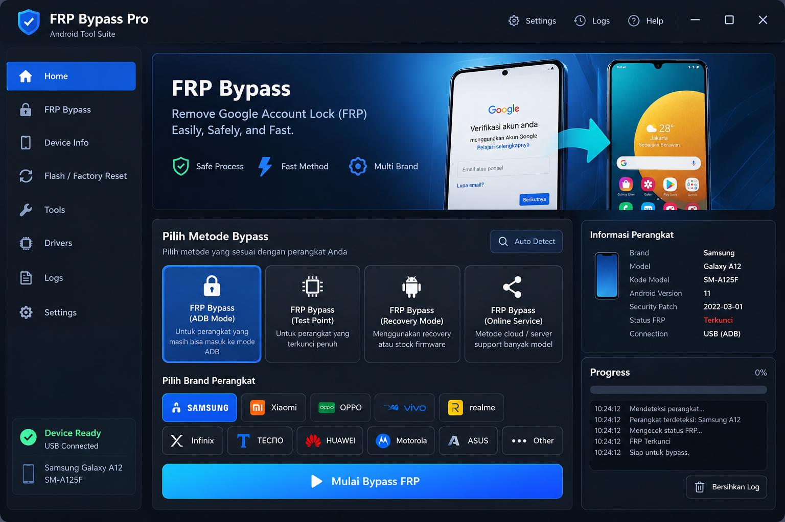

# DESIGN.md — FRP Recovery Assistant / Android Recovery & Diagnostics Suite

> **Versi revisi:** 2.1 — 23 Oktober 2026 (menambahkan §18 Akun & Sinkronisasi untuk Supabase opsional). Dokumen ini mengunci arah visual, states, dan perilaku komponen. Screenshot [`reference-ui.png`](./reference-ui.png) adalah referensi komposisi, proporsi, dan palette. Teks lama pada screenshot yang menyiratkan bypass tidak mengesampingkan label aman dan fitur yang ditetapkan `PRD.md`. Jangan mengganti UI dengan dashboard template generik atau mengubah desain utama tanpa persetujuan.

## 1. Target Visual

**Arah desain:** premium dark technical desktop utility — tajam, presisi, modern, profesional, bukan neon berlebihan dan bukan dashboard template AI.  
**Target screenshot:** 1536 × 1024 px.  
**Platform:** Windows desktop melalui Tauri 2.  
**Bahasa:** Bahasa Indonesia pada halaman operasional. Nama produk yang digunakan adalah `FRP Recovery Assistant`; istilah teknis umum boleh tetap berbahasa Inggris demi kejelasan.



### Prinsip yang tidak boleh dilanggar

1. Pertahankan komposisi 3 area: sidebar kiri, konten utama, dan panel informasi/progres di sisi kanan.
2. Background gelap biru-kehitaman; panel sedikit lebih terang; border biru-abu tipis.
3. Biru terang adalah warna aksi dan seleksi utama. Cyan hanya untuk aksen/gradient, hijau hanya untuk status berhasil/siap, merah untuk status error/terkunci yang benar-benar terverifikasi.
5. Tipografi tegas, bersih, dan mudah dibaca. Hindari font display futuristik, font rounded berlebihan, dan typography campur aduk.
5. Panel memakai sudut membulat moderat, garis batas halus, dan depth yang terkendali. Hindari glassmorphism berat, glow di semua elemen, dan bayangan besar.
6. Tidak boleh ada layout overflow, clipping teks penting, horizontal scrollbar, atau tombol yang keluar dari panel.
7. Jangan menggunakan seluruh screenshot sebagai background aplikasi. Implementasikan layout sebagai komponen native React supaya setiap control benar-benar interaktif.
8. Jangan menggunakan emoji sebagai pengganti ikon UI. Gunakan Lucide React atau aset SVG yang sah.
9. Semua dropdown pilihan yang terlihat wajib menggunakan komponen custom; popup native browser tidak boleh muncul.

## 2. Layout Grid dan Geometri

Semua nilai berikut merupakan target awal untuk window 1536 × 1024, lalu boleh memakai CSS grid/flex untuk mempertahankan proporsi pada ukuran lain.

- Window canvas: 1536 × 1024.
- Top bar: tinggi sekitar **84 px**, full width.
- Sidebar: mulai sekitar y=92 px; lebar sekitar **264 px**; margin kiri sekitar 13 px; margin bawah sekitar 24 px.
- Main content mulai sekitar x=297 px; jarak antar panel sekitar **16 px**.
- Hero banner: sekitar **1220 × 308 px** pada target screenshot; radius 12–14 px.
- Lower section: main panel kiri sekitar **824 px**, panel kanan sekitar **381 px**, gap sekitar **16 px**.
- Konten main panel: padding internal sekitar **20 px**.
- Method cards: empat kartu sama lebar dalam satu grid, gap sekitar **8 px**.
- Brand buttons: grid rapih dua baris pada target screenshot; jangan memaksa satu baris jika menyebabkan ukuran tombol tidak proporsional.
- Primary action: full width panel utama, tinggi sekitar **68–70 px**.
- Panel kanan: Device Information di atas Progress/Logs, gap sekitar **8–10 px**.

Gunakan grid/flex, `min-width: 0`, dan ukuran berbasis constraint. Jangan melakukan positioning absolut untuk seluruh halaman. Absolute positioning diperbolehkan hanya untuk detail dekoratif hero dan elemen kecil yang memang memerlukan overlay.

### Perilaku di ukuran lain

- Acuan pixel utama 1536 × 1024.
- Layout tetap nyaman pada window minimal sekitar 1200 × 760.
- Di bawah lebar desktop tersebut, sidebar dapat diciutkan dan area kanan boleh berpindah ke bawah konten utama; fungsi dan hierarchy harus tetap sama.
- Beri `min-height: 0` pada child flex yang perlu scroll dan gunakan scroll lokal untuk daftar log jika diperlukan.
- Jangan mengandalkan browser zoom atau fixed canvas yang memotong UI.

## 3. Design Tokens

Gunakan CSS custom properties dalam `src/styles/design-tokens.css` atau lokasi setara. Token ini adalah sumber warna utama.

```css
:root {
  color-scheme: dark;

  --bg-app: #080f19;
  --bg-titlebar: #0c1521;
  --bg-sidebar: #0d1825;
  --bg-panel: #111c2a;
  --bg-panel-raised: #152233;
  --bg-input: #0b1420;

  --border-subtle: #223246;
  --border-default: #34475d;
  --border-strong: #42617f;

  --text-primary: #f3f7ff;
  --text-secondary: #b8c9e2;
  --text-muted: #8598b2;

  --accent-blue: #1264f5;
  --accent-blue-hover: #2879ff;
  --accent-cyan: #10c8f5;
  --accent-cyan-soft: #174a73;
  --status-success: #35e6a0;
  --status-warning: #ffbd59;
  --status-danger: #ff5148;

  --gradient-primary: linear-gradient(105deg, #11c6ee 0%, #1689ff 48%, #1558f5 100%);
  --gradient-selected: linear-gradient(145deg, #174c91 0%, #1259ca 100%);

  --radius-sm: 8px;
  --radius-md: 10px;
  --radius-lg: 13px;
  --radius-xl: 16px;

  --space-1: 4px;
  --space-2: 8px;
  --space-3: 12px;
  --space-4: 16px;
  --space-5: 20px;
  --space-6: 24px;
  --space-8: 32px;
}
```

Token boleh disetel secara kecil setelah dibandingkan dengan screenshot, tetapi jangan mengganti keseluruhan palette. Hindari menyebar hex color berbeda-beda langsung pada komponen.

## 4. Tipografi

- Pilihan utama: **Inter Variable** yang dibundel secara lokal pada aplikasi jika lisensi dan paket proyek mendukung. Fallback: `Segoe UI`, `Arial`, `sans-serif`.
- Jangan mengimpor font dari Google Fonts pada runtime; aplikasi inti harus tetap tampil benar tanpa internet.
- Judul hero: 40–44 px, weight 700–750, line-height 1.08–1.15.
- Judul panel utama: 21–23 px, weight 650–700.
- Subjudul hero: 22–24 px, weight 450–550.
- Label kartu dan navigation: 15–16 px, weight 500–600.
- Body: 14–16 px, line-height 1.45–1.6.
- Caption/metadata: 12–13 px; jangan terlalu kecil untuk informasi status penting.
- Gunakan weight, ukuran, dan spacing untuk hierarchy; jangan membuat seluruh teks bold.

## 5. Window Title Bar

- Tinggi sekitar 84 px, background `--bg-titlebar`, garis bawah tipis.
- Kiri: ikon perisai biru 40–46 px, judul `FRP Recovery Assistant`, subtitle `Android Recovery & Diagnostics Suite`.
- Kanan: ikon/label `Settings`, `Logs`, `Help`, lalu minimize, maximize/restore, close.
- Kontrol jendela harus berfungsi pada Windows melalui API Tauri.
- Jika memakai custom titlebar tanpa dekorasi sistem, area kosong harus mendukung drag. Tombol interaktif tidak boleh ikut menyeret window.
- Hover/focus states halus dan jelas; tombol close mendapat warna peringatan hanya saat hover.

## 6. Sidebar Kiri

### Struktur

1. Home
2. FRP Recovery
3. AI Assistant
4. Device Info
5. Flash / Factory Reset
6. Tools
7. Drivers
8. Logs
9. Settings

### Styling

- Background panel gelap, border halus, radius sekitar 14 px.
- Item menu tinggi kira-kira 56–58 px dan memiliki padding horizontal sekitar 20 px.
- Ikon sekitar 22–25 px; label 15–16 px.
- Item aktif: fill biru `--accent-blue`, sedikit cyan di tepi kiri, teks dan ikon putih.
- Item nonaktif: teks `--text-secondary`; hover memakai panel sedikit lebih terang, bukan fill biru penuh.
- Bagian bawah sidebar memuat kartu koneksi. Ikon hijau dan tulisan `Device Ready` hanya boleh ditampilkan ketika perangkat sungguh terdeteksi dan status koneksi mendukungnya.
- Pada mode demo, tampilkan badge `DEMO`; jangan menampilkan data contoh seolah-olah koneksi USB sungguhan.

## 7. Hero Banner

- Lebar penuh kolom konten, tinggi sekitar 308 px.
- Background dark navy dengan glow biru terkontrol di tengah/kanan.
- Kolom teks kiri: judul `FRP Recovery`, subtitle dua baris yang mengikuti hierarchy screenshot.
- Di bawah subtitle, tiga benefit dengan ikon: `Safe Diagnostics`, `Guided Recovery`, `Multi Brand`.
- Kolom kanan: dua ilustrasi smartphone Android dan panah cyan di antaranya.
- Ilustrasi harus terlihat seperti bagian dari satu artwork, bukan gambar stok acak. Gunakan SVG/vector atau asset proyek yang disiapkan khusus; jaga agar teks kecil di layar ponsel tidak menjadi fokus utama.
- Pastikan kontras teks pada sisi kiri tetap tinggi meskipun ada glow.
- Hero harus tetap tertata pada lebar yang lebih kecil; ilustrasi boleh diskalakan/crop secara terkendali, jangan menimpa teks.

## 8. Panel Utama: Metode dan Brand

### Header panel

- Judul `Pilih Jalur Pemulihan` dengan hierarchy dan posisi yang sama seperti referensi.
- Subtitle `Pilih jalur diagnosis yang sesuai dengan perangkat Anda`.
- Tombol outline `Auto Detect` di kanan atas dengan ikon search.
- Panel background `--bg-panel`, border `--border-subtle`, radius 12–14 px.

### Empat kartu metode

Urutan dan label visual:

1. `ADB Diagnostics`
2. `Recovery / Fastboot Guide`
3. `Account Recovery`
4. `Official Service`

Kartu diisi ikon yang jelas, judul 2 baris bila dibutuhkan, dan deskripsi singkat 2–3 baris. Kartu pertama selected pada screenshot referensi; selected style memakai latar biru-gradient, border biru terang, dan fokus visual yang jelas. Kartu lain memakai panel gelap dan border abu-biru.

Kartu ini hanya memilih jenis diagnosis/panduan yang didukung. Jangan menambahkan exploit, test-point bypass, server bypass, atau prosedur untuk menghindari proteksi anti-pencurian. Deskripsi harus akurat terhadap tindakan yang benar-benar tersedia.

### Pilih Brand Perangkat

Urutan visual target:

- Baris pertama: Samsung, Xiaomi, OPPO, vivo, realme.
- Baris kedua: Infinix, TECNO, HUAWEI, Motorola, ASUS, Other.

- Tombol brand berbentuk persegi panjang kompak dengan radius 9–10 px, background dark, border halus, ikon/logo ringkas, dan label.
- Samsung aktif pada referensi: fill biru kuat dengan label putih.
- Hanya satu brand boleh aktif. Brand terdeteksi otomatis boleh menjadi pilihan awal, tetapi pengguna dapat memilih `Other`.
- Hindari logo yang kabur atau berbeda proporsi. Gunakan logo resmi berlisensi/diizinkan jika tersedia; bila tidak, gunakan teks atau glyph sederhana, jangan meniru logo secara asal.

### Tombol aksi utama

- Full width pada bagian bawah panel.
- Tinggi 68–70 px, radius sekitar 12 px.
- Gradient `--gradient-primary`, ikon play/progress di tengah-kiri label, teks tebal 19–21 px.
- Hover: brightness naik sedikit; active: kedalaman turun sedikit; disabled: warna redup dan cursor/label status jelas.
- Gunakan label **`Mulai Diagnosis`** atau **`Mulai Diagnosis FRP`**. Label pada screenshot yang lama tidak digunakan sebagai label operasional karena dapat menjanjikan bypass yang tidak tersedia.
- Ketika proses sedang berjalan, tombol berubah menjadi `Batalkan Diagnosis` bila pembatalan aman didukung; jangan membuat tombol seolah aktif tanpa handler.

## 9. Panel Kanan

### Informasi Perangkat

- Card di atas dengan judul `Informasi Perangkat`.
- Kiri: ilustrasi ponsel kecil atau ikon device.
- Kanan: pasangan label/value:
  - Brand
  - Model
  - Kode Model
  - Android Version
  - Security Patch
  - Status FRP
  - Connection
- Label memakai `--text-secondary`, value menggunakan `--text-primary` dan bobot 600.
- Status merah `Terkunci` hanya boleh ditampilkan bila nilai tersebut benar-benar tersedia dan tervalidasi. Jika tidak, tampilkan `Tidak dapat diverifikasi`.
- Gunakan baseline alignment yang rapi. Label dan value harus tetap terbaca dan tidak saling bertabrakan pada ukuran window kecil.

### Progress & Logs

- Card kedua tepat di bawah Informasi Perangkat.
- Header: `Progress` kiri, persentase kanan.
- Progress track warna slate, fill cyan/blue; animasi halus dan tidak mengalihkan perhatian.
- Log panel di bawah track dengan background lebih gelap, border tipis, radius 9–10 px.
- Tiap baris: waktu, pesan. Pada detail teknis boleh ada severity icon kecil.
- Tombol `Bersihkan Log` di kanan bawah dengan ikon trash; gaya outline, bukan tombol utama.
- Log yang panjang memakai scroll internal. Jangan mengubah tinggi seluruh halaman saat log bertambah.
- Gunakan timestamp dari data proses nyata. Data demo harus ditandai sebagai demo.

## 10. Komponen dan Aturan Reuse

Bangun komponen reusable sekurang-kurangnya:

- `AppTitleBar`
- `AppSidebar`
- `SidebarNavItem`
- `HeroBanner`
- `MethodCard`
- `BrandButton`
- `PrimaryActionButton`
- `DeviceInfoPanel`
- `ConnectionStatusCard`
- `ProgressPanel`
- `LogViewer`
- `EmptyState`
- `StatusBadge`
- `ConfirmDialog`
- `Toast/InlineAlert`
- `AppSelect` (dropdown custom standar)
- `AppCombobox` (pilihan dengan pencarian)
- `DropdownMenu` (menu aksi)
- `AiAssistantPanel`
- `AiMessage`
- `AiConsentDialog`
- `AiContextPreview`
- `DataPreservationBanner`

Semua komponen perlu memiliki state default, hover, focus-visible, active, disabled, loading, empty, success, dan error yang relevan. Jangan menggandakan markup atau styling tiap halaman bila komponen yang sama bisa dipakai kembali.

## 11. Iconography, Motion, dan Feedback

- Gunakan Lucide React dengan stroke konsisten, ukuran 18–24 px sesuai konteks.
- Hindari mencampur ikon outline, 3D, dan filled style secara acak.
- Durasi animasi umum: 120–220 ms; easing halus.
- Hormati `prefers-reduced-motion`.
- Progress animation tidak boleh menyimulasikan keberhasilan. Progress harus berasal dari tahapan proses yang benar atau menggunakan step indeterminate bila persentase tidak diketahui.
- Toast dan status error tidak boleh hanya menggunakan warna; sertakan teks/icon.
- Setiap tombol dengan tampilan interaktif wajib memiliki aksi yang nyata.

## 12. Form Controls dan Dialog

- Semua dropdown pilihan yang terlihat wajib memakai custom select/combobox dengan style proyek. Dilarang memakai popup `<select>` native browser atau `<datalist>`.
- Implementasikan `AppSelect` dari primitive aksesibel, disarankan Radix UI Select; styling popup, trigger, option, separator, selected state, chevron, dan focus wajib berasal dari komponen proyek.
- `AppCombobox` dipakai untuk pilihan yang perlu pencarian; input dan hasilnya tetap harus custom, bukan `<datalist>`.
- Focus ring jelas dan sejalan dengan aksen cyan/blue. Keyboard: Enter/Space buka/pilih, Arrow Up/Down navigasi, Escape menutup dan mengembalikan fokus, typeahead bila sesuai.
- Popup harus tetap berada di atas panel/window, tidak terpotong overflow, memiliki max-height serta scroll internal, dan menutup saat klik di luar.
- Semua dropdown memiliki state default, hover, active, selected, focus-visible, disabled, loading, empty, dan error bila relevan.
- Native OS file chooser hanya diperbolehkan untuk dialog pemilihan file/folder sistem; bukan sebagai pengganti dropdown aplikasi.
- Dialog konfirmasi punya judul, dampak tindakan, tombol batal, dan tombol tindakan. Tidak boleh ada operasi destruktif di belakang satu klik tanpa konfirmasi.
- Validasi inline muncul dekat field, dengan pesan spesifik.

## 13. Accessibility dan Contrast

- Gunakan struktur heading yang masuk akal dan label yang terkait ke kontrol.
- Navigasi keyboard harus berfungsi, dengan `focus-visible` yang jelas.
- Jangan menyampaikan status hanya melalui warna.
- Target kontras teks/body mengikuti WCAG AA sejauh praktis; teks metadata jangan terlalu pucat atau kecil.
- Tombol dan item interaktif memiliki hit area yang cukup.
- Semua ikon bermakna mempunyai accessible name; ikon dekoratif disembunyikan dari screen reader.

## 14. Do / Don't

### DO

- Cocokkan screenshot terlebih dahulu pada 1536 × 1024.
- Gunakan warna/token dan spacing yang konsisten.
- Buat dashboard terlihat padat namun tetap rapi seperti referensi.
- Gunakan data demo yang jelas dibedakan dari hasil perangkat nyata.
- Uji perubahan UI dengan screenshot regression pada ukuran referensi.

### DON'T

- Jangan mengubah layout menjadi sidebar kecil + banyak card generik.
- Jangan mengganti warna utama menjadi ungu, hijau, putih terang, atau palette baru.
- Jangan menambahkan gradient/glow ke semua kartu.
- Jangan menggunakan emoji, logo asal, placeholder lorem ipsum, atau font acak.
- Jangan mengisi semua panel dengan angka dummy tanpa status Demo.
- Jangan mengklaim proses berhasil jika backend tidak menjalankan tindakan yang dimaksud.
- Jangan memasukkan logika bypass FRP/exploit ke event handler UI.

## 15. Visual QA Checklist

Sebelum menyatakan UI selesai, bandingkan screenshot build dengan `reference-ui.png` di 1536 × 1024:

- [ ] Tinggi title bar dan posisi kontrol window sesuai.
- [ ] Sidebar, item aktif, dan kartu status berada di proporsi benar.
- [ ] Hero memiliki ketinggian, hierarchy teks, dan artwork kanan yang seimbang.
- [ ] Panel utama dan kanan mengikuti rasio, gap, dan alignment referensi.
- [ ] Empat kartu metode serta dua baris brand selector tertata rapi.
- [ ] Primary button berada pada bagian bawah panel dan selebar konten.
- [ ] Informasi perangkat dan progress/log panel punya padding konsisten.
- [ ] Font, weight, line-height, radius, border, dan gradient sesuai token.
- [ ] Tidak ada overflow, clipping, layout shift, atau scrollbar horizontal.
- [ ] Active/hover/disabled/loading/error states diuji.
- [ ] Screenshot comparison dilakukan, bukan sekadar mengandalkan penilaian kode.

**Standar akhir:** pertahankan kualitas visual, proporsi, palette, dan hierarchy screenshot referensi, tetapi gunakan nama dan label operasional baru dari PRD. Hasil harus terasa sebagai aplikasi desktop yang sama secara visual—bukan desain baru yang hanya mengambil warna dan tema gelapnya. Semua dropdown harus custom, dan halaman AI harus menyatu dengan sistem visual yang ada.


## 16. Custom Dropdown / Select System

### Prinsip wajib

- Tidak boleh ada tampilan popup pilihan native browser yang terlihat pengguna. Semua kontrol pilihan aplikasi harus konsisten, khusus, dan mengikuti tema dark premium pada token proyek.
- Gunakan komponen `AppSelect` yang dibungkus dari Radix UI Select atau primitive aksesibel setara yang telah dipatok di dependency lockfile. Jangan membangun keyboard/ARIA behavior dari nol jika primitive teruji tersedia.
- Walaupun library dapat menggunakan input tersembunyi untuk integrasi form, popup visual harus sepenuhnya berupa menu/listbox custom; tidak boleh jatuh kembali ke UI dropdown browser.
- Sediakan `AppCombobox` ketika jumlah pilihan besar atau perlu search/filter. Search box, filtered list, empty result, clear button, dan keyboard interaction harus di-styling sendiri.

### Visual specification

- Trigger: tinggi 42–46 px (variasi field padat diperbolehkan), background `--bg-input`, border `--border-default`, radius `--radius-md`, padding horizontal 12–14 px.
- Label pilihan: `--text-primary`; placeholder: `--text-muted`; chevron Lucide berukuran 16–18 px.
- Hover: border naik ke `--border-strong`; focus-visible: ring cyan/blue yang jelas, tidak hanya berganti warna.
- Popup: `--bg-panel-raised`, border `--border-default`, radius 10–12 px, shadow halus; z-index token terstandar; lebar mengikuti trigger atau minimum sesuai konten.
- Option: minimum tinggi target 38 px, padding 8–12 px, teks 14–15 px, selected state terlihat dengan check icon atau indikator yang konsisten. Hover dan selected tidak boleh hanya dibedakan oleh warna.
- Gunakan max-height dengan scroll internal untuk daftar panjang. Menu tidak boleh keluar dari window atau tertutup titlebar/panel.
- Animation 120–180 ms; hormati `prefers-reduced-motion`.

### States dan behavior

- Default, hover, pressed, focused, selected, disabled, loading, empty, validation error, dan open states harus disediakan sesuai konteks.
- Enter/Space membuka dan memilih; Arrow Up/Down bergerak; Escape menutup dan mengembalikan fokus; typeahead/search berfungsi bila relevan; klik di luar menutup menu.
- Label programatik, `aria-expanded`, `aria-controls`, serta semantics listbox/option harus tepat. Pastikan pembaca layar mengetahui pilihan aktif.
- Controlled state harus mengikuti React state; nilai yang dipilih tidak boleh sekadar berubah secara visual tanpa pembaruan state/model.
- Terapkan komponen sama di Settings, filter Logs, pilihan provider/model AI, pilihan bahasa/tema, serta setiap form lain. Jangan buat implementasi dropdown yang berbeda-beda per halaman tanpa alasan.

### Visual QA

- Capture screenshot kondisi menu tertutup dan terbuka pada 1536×1024.
- Uji daftar panjang, item disabled, pilihan aktif, keyboard-only, focus return, window resize, clipping, dan tema gelap.
- Review kode dan screenshot untuk memastikan tidak ada native select popup, browser datalist, atau style dropdown yang tidak konsisten.

## 17. AI Assistant UI

### Lokasi dan layout

- Tambahkan `AI Assistant` sebagai item sidebar sesudah `FRP Recovery`, memakai icon Lucide `bot` atau icon assistant yang konsisten.
- Pertahankan struktur aplikasi: title bar + sidebar + workspace utama + panel status/log; halaman AI menggunakan workspace yang sama dan tidak merombak komposisi dashboard.
- Halaman AI menampilkan heading `AI Recovery Assistant`, status provider (`Siap`, `Belum dikonfigurasi`, `Offline`, `Memproses`, atau `Error`), serta catatan ringkas bahwa AI membantu diagnosis dan tidak membuka PIN/FRP secara otomatis.
- Layout percakapan: area pesan/hasil yang bisa scroll, composer input di bawah, tombol kirim, dan panel `Konteks diagnosis` yang dapat dilihat/dikonfirmasi sebelum dikirim.
- Jangan membuat UI seperti chat generik yang mengambil alih semua halaman. Gunakan border, spacing, typography, dan background yang sama dengan produk.

### Message anatomy

- Pesan pengguna dan AI memiliki alignment serta permukaan yang berbeda tetapi tetap kalem; hindari bubble neon/glow berlebihan.
- Respons AI yang berisi analisis menggunakan kelompok yang jelas: `Temuan`, `Langkah aman berikutnya`, `Risiko`, dan `Sumber resmi` bila relevan.
- Bedakan data perangkat nyata, informasi yang dimasukkan pengguna, dan dugaan AI dengan label teks, bukan hanya warna.
- Link bantuan resmi harus jelas sebagai link eksternal dan tidak diganti dengan URL yang diarang.
- AI loading/error/empty state harus informatif. Jangan menampilkan spinner tanpa akhir; sediakan `Coba lagi` jika aman.
- Composer memiliki disabled/loading/error states, batas karakter, dan tidak meminta PIN, pola, password, OTP, token, atau recovery code.

### Consent dan privasi

- Saat provider cloud aktif, sebelum konteks diagnosis pertama kali dikirim, tampilkan `AiConsentDialog` dengan provider, data yang akan dibagikan (contoh: brand/model bila diketahui, jenis koneksi, log yang sudah disanitasi, pertanyaan pengguna), tujuan, dan tindakan `Kirim konteks` / `Batal`.
- Pengguna bisa menghapus log atau mengecualikan data konteks sebelum mengirim.
- Status `AI nonaktif` atau `Belum dikonfigurasi` tidak boleh terlihat seolah-olah AI sedang menjawab.
- Simpan riwayat percakapan hanya jika user mengaktifkan setting tersebut; default off.

### Safety states

- Tambahkan `DataPreservationBanner` ketika pengguna menyatakan data penting atau backup belum diketahui: `Prioritas: pertahankan data — jangan reset/flash sebelum memahami risiko.`
- AI tidak boleh memicu aksi device. Untuk MVP, CTA pada respons AI hanya `Lihat panduan`, `Salin checklist`, atau `Jalankan pemeriksaan aman` yang terhubung ke fungsi allowlist nyata.
- Jika AI menyarankan langkah destruktif, sistem harus menolaknya atau menampilkan peringatan yang mengarahkan kembali ke kebijakan PRD. Tidak boleh ada automatic execution.
- Desain panel tetap usable jika layanan AI tak tersedia; sertakan shortcut ke halaman diagnosis manual dan bantuan resmi.

### States required for QA

- Empty conversation, prompt suggestions, processing, response success, network timeout, quota/provider error, invalid configuration, consent canceled, sensitive data redacted, retry, history cleared, and AI disabled.

## 18. Akun & Sinkronisasi (Supabase, opsional)

### Lokasi

- Bagian `Akun & Sinkronisasi` di halaman Settings, memakai panel, tipografi, dan komponen yang sama (`AppSwitch`, `AppSelect`, `ConfirmDialog`, `InlineAlert`). Jangan menambah item sidebar baru dan jangan mengubah komposisi utama.
- Status sinkron ringkas boleh tampil sebagai teks + ikon kecil di Settings dan halaman Logs; jangan memakai warna hijau `Device Ready` untuk status cloud.
- Laporan yang dibagikan ke tim diberi label teks `Dibagikan ke tim`, bukan hanya ikon/warna.

### States wajib

- `Tidak masuk` (default) — fitur lokal penuh, tombol `Masuk` jelas.
- `Masuk…`, `Masuk gagal` (pesan spesifik + `Coba lagi`).
- `Sinkron nonaktif` (sudah login, belum consent) — tombol `Aktifkan sinkron` membuka dialog consent dengan pratinjau kategori data, tujuan, dan cara menonaktifkan.
- `Tersinkron` (waktu terakhir sinkron), `Menunggu sinkron` (antrean offline + jumlah item), `Offline`, `Error sinkron` (pesan + `Coba lagi`).
- `Consent dibatalkan`, `Keluar akun`, `Hapus data cloud` (lewat `ConfirmDialog` yang menjelaskan dampaknya).

### Aturan visual

- Ikuti token yang ada; tidak ada palette baru untuk cloud. Gunakan `--accent-cyan` untuk info sinkron, `--status-warning` untuk antrean/offline, `--status-danger` untuk error.
- Form login tidak boleh meminta kredensial akun Google/produsen perangkat; hanya akun aplikasi (Supabase Auth).
- Status cloud tidak boleh disampaikan hanya dengan warna; sertakan teks.
